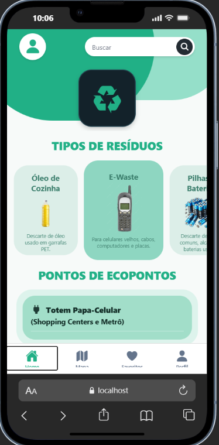
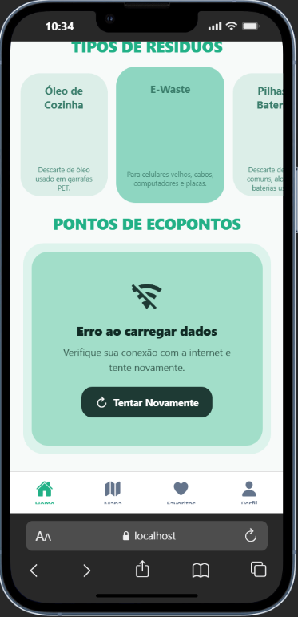
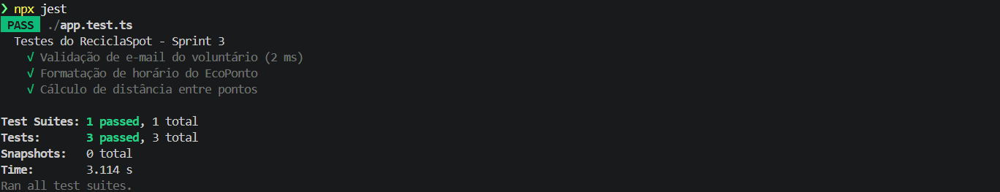

# ♻️ ReciclaSpot

Aplicativo móvel desenvolvido em React Native + Expo para localização de ecopontos municipais, registro de descarte consciente e consulta offline de pontos de coleta.

## Funcionalidades Entregues
- **Fluxo de Entrada e Cadastro:** Telas de boas-vindas (`Welcome`) e cadastro de voluntário (`Voluntario`) com validação de formulário e persistência local.
- **Mapa Interativo e GPS:** Geolocalização em tempo real (`expo-location`), pinos coloridos por categoria de resíduo e card flutuante de resumo.
- **Resiliência Offline:** Armazenamento local com `AsyncStorage` permitindo consultar ecopontos mesmo em Modo Avião.
- **Integração REST & Clean Code:** Consumo de API via `Axios` com timeout, tratamento de falhas, Pull-to-Refresh e testes unitários com `Jest`.

## Tecnologias Utilizadas
- React Native & Expo (TypeScript)
- React Navigation (Stack + Bottom Tabs)
- React Native Maps & Leaflet (Web)
- Expo Location & AsyncStorage
- Axios & Jest

## Capturas de Tela

### Tela Inicial (Listagem e Filtro de Ecopontos)

### Tratamento de Erro de Conexão (Resiliência de Rede)

### Testes Unitários (Jest)

## Como Executar Localmente
\`\`\`bash
# Instalar dependências
npm install

# Rodar os testes unitários
npm test

# Iniciar o projeto
npx expo start
\`\`\`

## Download do Aplicativo (APK Android)
- [Baixar APK - Versão Preview (Demo Day)](COLE_AQUI_O_LINK_DO_SEU_APK_DO_EXPO)

